# Brightloop — Subscription Management System

One unified platform that runs the full life of a subscription business: set up products
and plans, sell them, bill automatically every month, collect payments, and report
recurring revenue — without a spreadsheet anywhere in the loop.

> Built for the *Brightloop Software* brief: a company that earns its money every month,
> not just once.


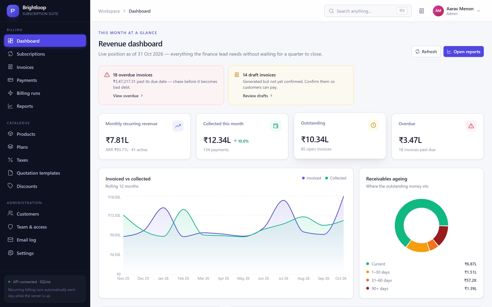

---

## Table of contents

1. [What this solves](#1-what-this-solves)
2. [The five scenes, mapped to features](#2-the-five-scenes-mapped-to-features)
3. [Tech stack, architecture & database design](#3-tech-stack)
4. [Run the application (Docker & Local)](#4-run-the-application)
5. [Demo accounts](#5-demo-accounts)
6. [Project structure](#6-project-structure)
7. [How the hard parts work](#7-how-the-hard-parts-work)
8. [API reference](#8-api-reference)
9. [Testing & CI/CD pipeline](#9-testing)
10. [Troubleshooting](#10-troubleshooting)

---

## 1. What this solves

| How Brightloop ran before | How it runs now |
| --- | --- |
| Subscriptions tracked in a spreadsheet | A subscription record with a state machine, plan rules and a full audit trail |
| Renewals remembered by whoever notices first | A billing sweep that runs daily, catches up on missed periods, renews or closes at term end |
| Invoices typed up by hand every month | Invoices generated from the subscription with lines, taxes and discounts already filled in |
| Payments matched by scrolling bank statements | Payments recorded against an invoice; balance, state and overdue ageing update instantly |
| Revenue reports built at the end of each quarter | A live dashboard and filterable reports — MRR, collections, ageing, churn |

Three roles see three different systems: **admin** controls everything, **staff** handle
day-to-day work with limited access, **customers** get a self-service portal that only ever
shows their own records.

---

## 2. The five scenes, mapped to features

<details open>
<summary><strong>Scene 1 — A new customer signs up</strong></summary>

- Self-service signup with **unique email** (enforced by a `UNIQUE COLLATE NOCASE` index)
  and a **password policy of more than 8 characters, one uppercase, one lowercase and one
  special character** — validated on the server *and* shown live in the UI as a strength meter.
- **Forgot / reset password** issues a single-use, 60-minute token. Because no SMTP server is
  configured in development, the message (and the link) lands in the built-in **Email log** —
  so the whole flow is testable end to end.
- **Role-based access**: `admin` / `staff` / `customer`, enforced by middleware on every route.
  Only the admin sees *Team & access* and can add a staff member.
- A customer hitting `/app/subscriptions/999` gets a 403, not someone else's data.

*Screen:* `/login`, `/signup`, `/forgot-password`, `/reset-password`, `Team & access`

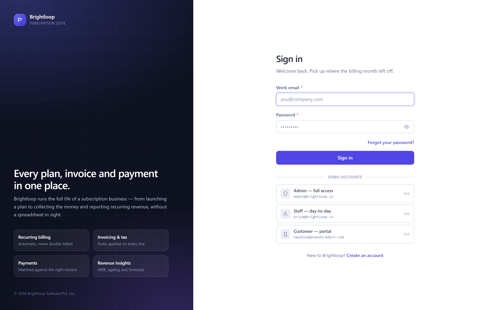
</details>

<details open>
<summary><strong>Scene 2 — Launching a new plan</strong></summary>

- **Products** carry name, type, sales price, cost price and notes, plus **variants** —
  e.g. brand `Odoo` adds **560** to the base price (the exact example from the brief).
- **Tax rules** are created once by the admin and attached to products; every invoice line
  picks up the right rate automatically by product type.
- **Plans** define price, cadence (`daily / weekly / monthly / yearly`), interval count,
  minimum quantity and an availability window — plus four per-plan switches:
  *can be closed early*, *can be paused*, *can be renewed*, *auto-close at term end*.
  The server refuses a transition the plan does not allow.

*Screen:* `/app/products`, `/app/plans`, `/app/taxes`

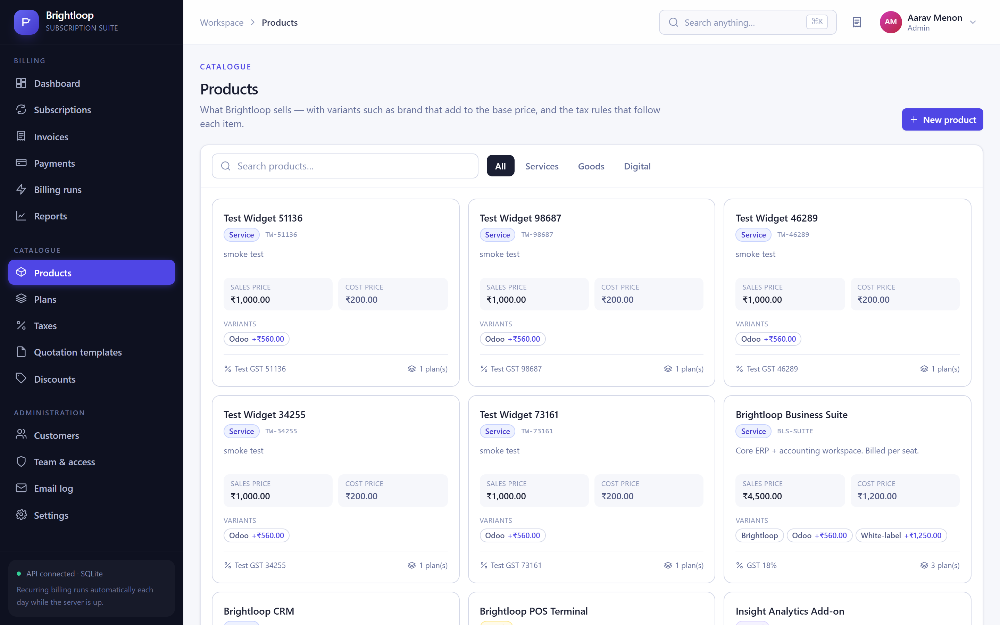
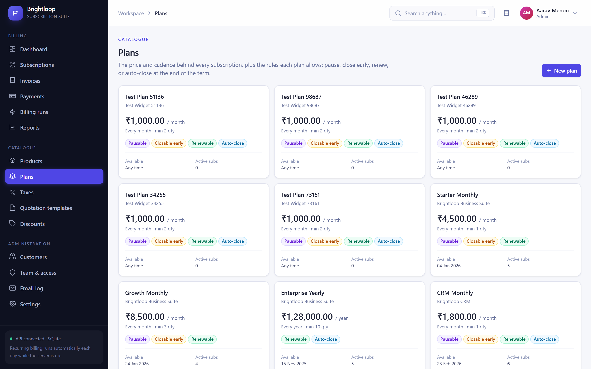
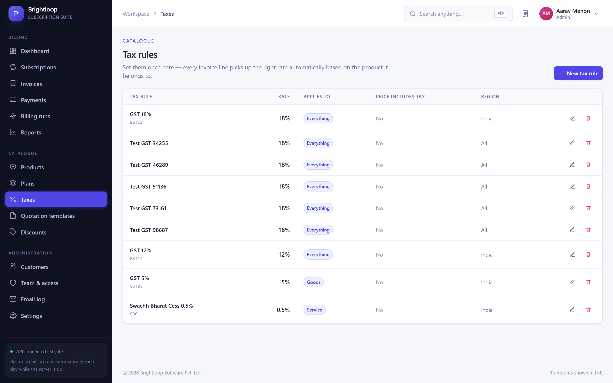
</details>

<details open>
<summary><strong>Scene 3 — Turning a quote into a subscription</strong></summary>

- **Quotation templates** hold a plan, a set of product lines and a validity period
  (e.g. 45 days). The "New subscription" dialog can start from one with a single click.
- Every subscription gets its own number (`SUB-2026-0042`), a customer, a plan, start and
  expiry dates, payment terms, and lines with product, quantity, unit price, tax and amount.
- The state machine is enforced server-side:
  **Draft → Quotation → Confirmed → Active → Closed** (with `Paused` and `Cancelled`
  as side states). The detail page shows a stepper so anyone on the team can see where it stands.

*Screen:* `/app/templates`, `/app/subscriptions`, `/app/subscriptions/:id`

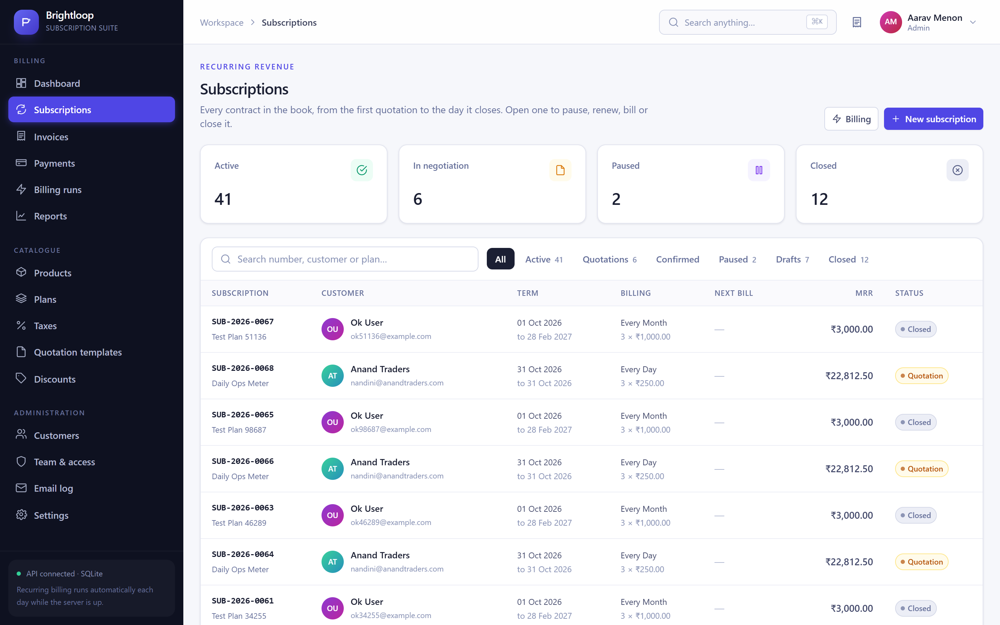
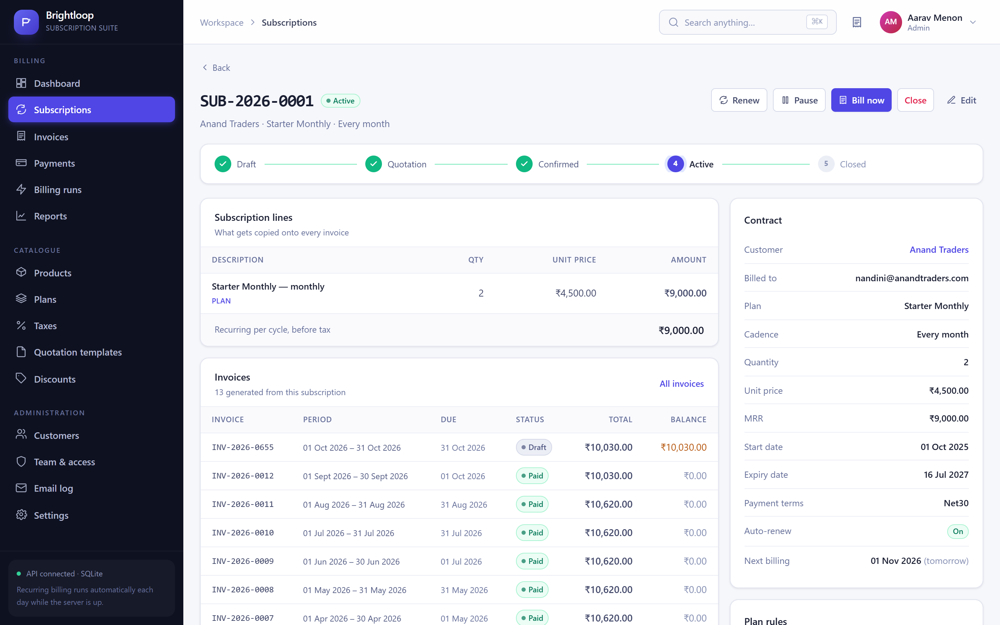
</details>

<details open>
<summary><strong>Scene 4 — Billing day</strong></summary>

- **One button** sweeps every active subscription due on or before a chosen date.
  Hundreds of invoices are built from their subscriptions — customer, lines, taxes and totals
  already filled in.
- **Nothing is billed twice.** A partial unique index on
  `(subscription_id, period_start, period_end)` makes a duplicate invoice physically
  impossible; the sweep reports the skipped ones instead.
- **Nothing is skipped.** If the server was down for a week, a daily plan still produces each
  missed period on the next run (verified by the test suite).
- Taxes come from the admin's rules; the invoice shows a per-line rate and a tax summary.
- The team can **confirm** (individually or in bulk), **cancel**, **send** (emails the
  customer and records `sent_at`) and **print** any invoice. State flows
  **Draft → Confirmed → Paid**.

*Screen:* `/app/billing`, `/app/invoices`, `/app/invoices/:id` (print-ready A4 sheet)

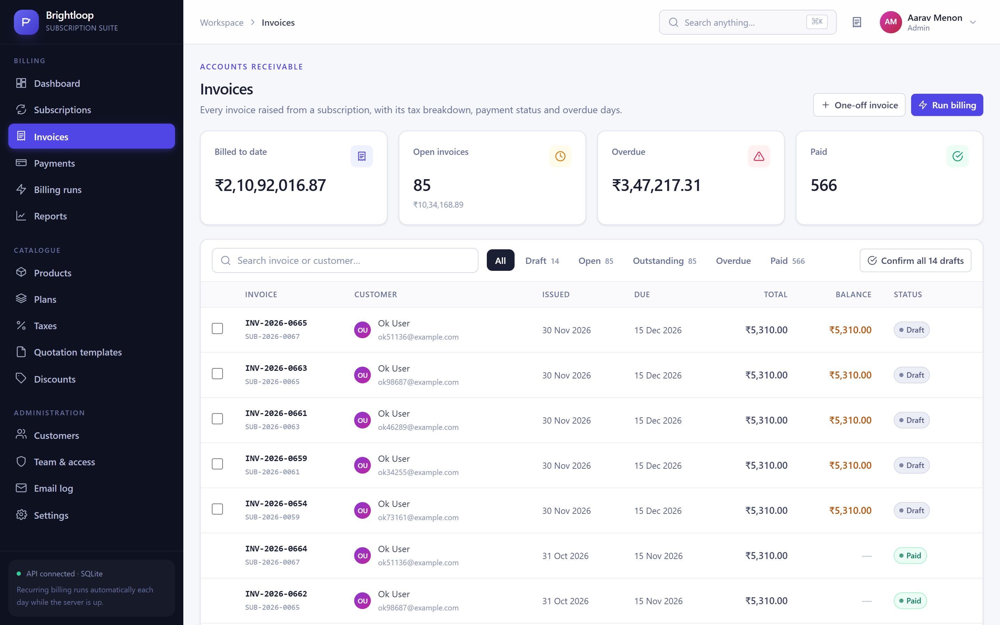
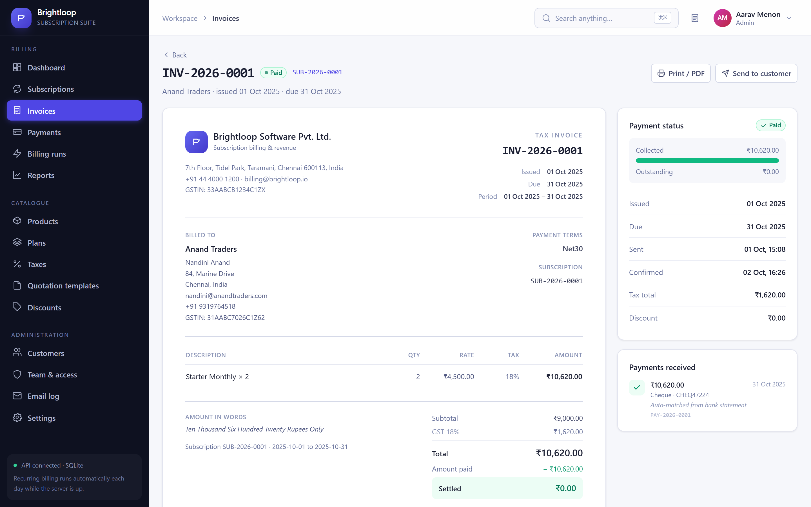
</details>

<details open>
<summary><strong>Scene 5 — A customer asks for a better price</strong></summary>

- Only the **admin** can create discount rules — the API returns 403 for staff.
- A rule is a **fixed amount or a percentage**, with a **minimum purchase value, minimum
  quantity, start and end dates, and a usage cap**, applying either to **specific products**
  or to the **whole subscription**.
- When an invoice is generated, every live rule is evaluated and the **most generous
  qualifying one is applied automatically** — rules never stack, so the customer always gets
  the best deal and finance never over-discounts.
- The discount appears on the invoice line *and* in `discount_total`, and a usage row is
  written so `max_uses` actually runs out. A rule **stops applying on its own** the moment it
  expires or hits its cap — the *Discounts* screen labels each rule Live / Scheduled / Expired /
  Exhausted, and a simulator shows which rule would fire for a given order.

*Screen:* `/app/discounts`

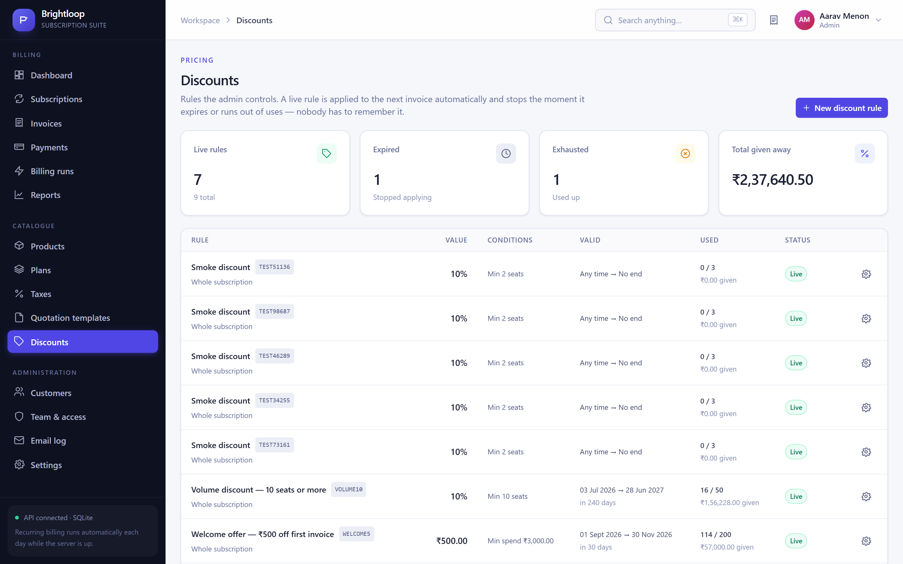
</details>

<details open>
<summary><strong>Scene 6 — The money comes in, and the finance lead's month end</strong></summary>

- Payments are recorded against an invoice with **method** (bank transfer, UPI, card, cheque,
  Razorpay, Stripe, cash, write-off), **amount**, **date**, **reference** and **note**.
  Partial payments are supported; the invoice flips to **Paid** the moment the balance reaches zero.
  Overpaying is rejected. An admin can reverse a payment and the invoice reopens.
- The **dashboard** answers the finance lead's four questions on one screen: how many
  subscriptions are active, how much revenue came in, how much is still owed, and which
  invoices are overdue — with trend arrows and click-through to the filtered list.
- **Reports** add date filters, grouping by month / customer / plan / payment method,
  receivables ageing buckets (current, 1–30, 31–60, 61–90, 90+), churn and CSV export.
- **Performance:** every list is paginated and every hot query is indexed. With the seeded
  dataset (650+ invoices, 570+ payments) all report endpoints answer in **under 10 ms** ?
  the test suite asserts the two-second budget.

*Screen:* `/app/reports`, `/app/billing`

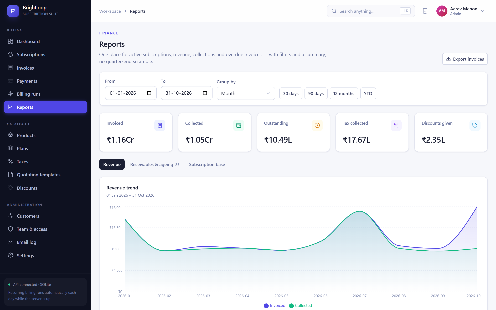
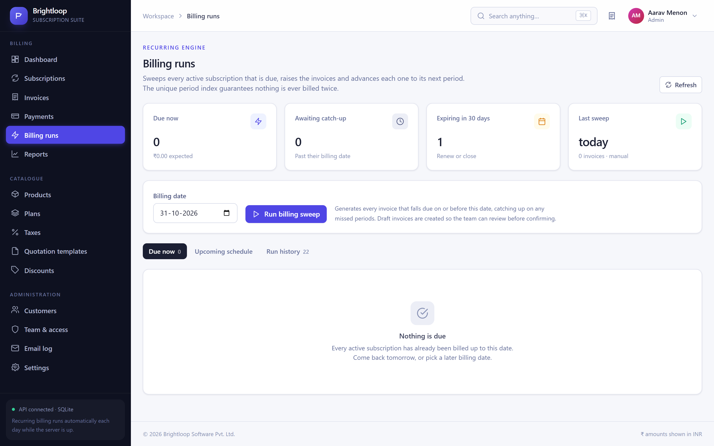
</details>

<details open>
<summary><strong>Scene 7 ? Customer Self-Service Portal</strong></summary>

- Customers log into their own dedicated portal (`/portal`) to browse plans, request new subscriptions, view active services, inspect past invoices, and track payment history.
- Strict isolation ensures customers only ever access their own records.

*Screen:* `/portal`, `/portal/plans`, `/portal/subscriptions`, `/portal/invoices`

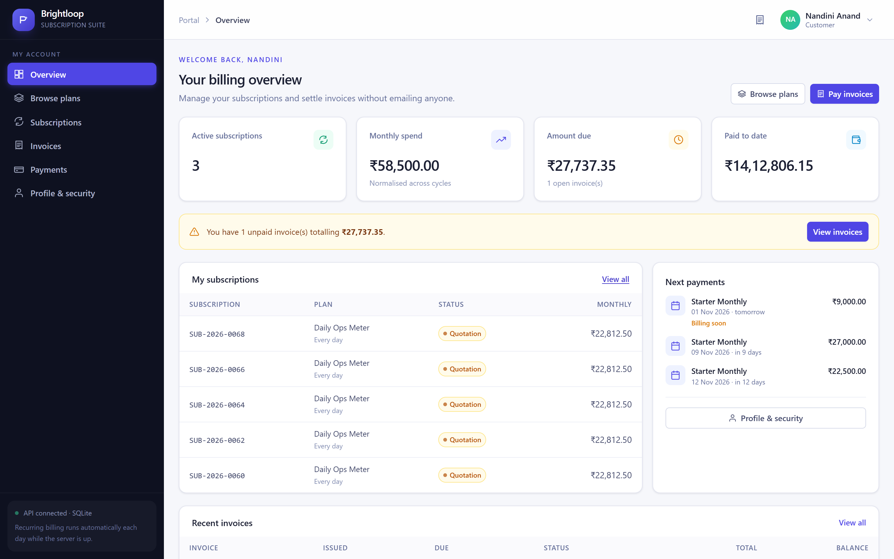
</details>

---

## 3. Tech stack

| Layer | Choice | Why |
| --- | --- | --- |
| Frontend | **React 18 + Vite** | Fast dev server, instant HMR, tiny build |
| Styling | **TailwindCSS 3** | A coherent design system without a component library dependency |
| Charts | **Recharts** | Composable SVG charts that render well in print and preview |
| Routing | **react-router-dom 6** | Role-aware route guards |
| Backend | **Node 18+ / Express 4** | Small, transparent, easy to read |
| Database | **SQLite (better-sqlite3)** | Zero-install, synchronous, transactional — ideal for a self-contained demo that still behaves like a real billing engine |
| Auth | **JWT + bcryptjs** | Stateless sessions, hashed passwords |
| Validation | Hand-written guards + SQL constraints | Errors surface as readable messages, integrity is enforced by the database too |

There is **no external service to configure**. Clone, `npm install`, seed, run — it works offline.

### System architecture

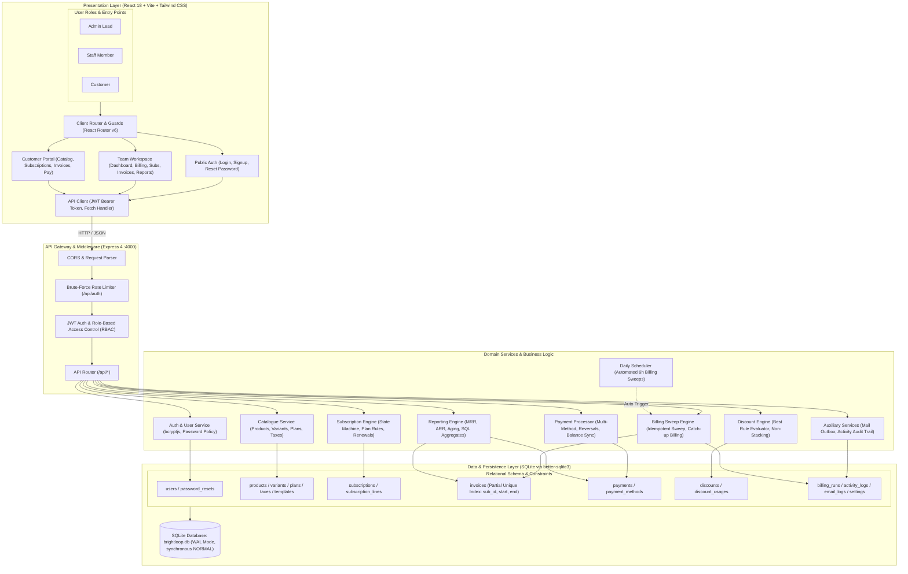

### Use case diagram

The diagram below illustrates the role boundaries and operational workflows across customers, staff, and administrators:

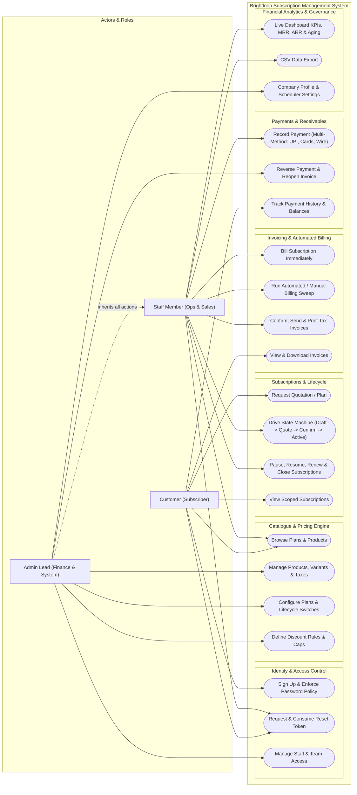

### Database design (Entity-Relationship Diagram)

The SQLite database (`server/data/brightloop.db`) is tuned for transactional integrity and high-concurrency read-heavy billing (`journal_mode = WAL`, `synchronous = NORMAL`, `foreign_keys = ON`, `temp_store = MEMORY`).

The ER diagram below details the 21 relational tables, data types, keys, and entity cardinality across user accounts, the product catalogue, subscription state engines, billing cycles, invoices, payments, and audit logs:

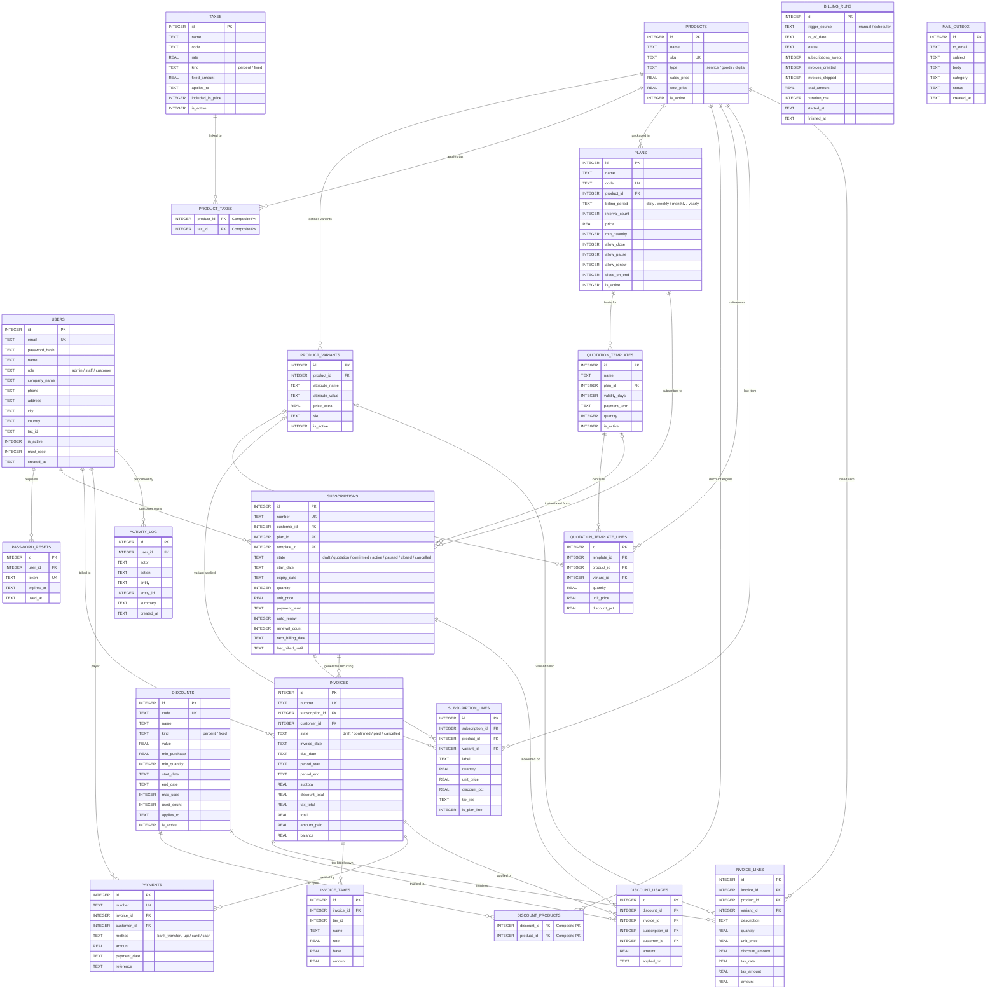

---

## 4. Run the application

### Option A: Run with Docker (One-command setup)

The entire platform (API, built React client, SQLite database, and auto-seeder) is fully containerized:

```bash
# Start the full platform with Docker Compose:
docker compose up -d

# Check health and container status:
docker compose ps

# Follow live server logs:
docker compose logs -f
```

The application is immediately available at **http://localhost:4000** with pre-seeded demo accounts.

To stop the container:
```bash
docker compose down
```

Or using Docker directly:
```bash
docker build -t brightloop:latest .
docker run -d -p 4000:4000 --name brightloop-app brightloop:latest
```

### Option B: Run locally in VS Code (step by step)

### Prerequisites

- **Node.js 18.18 or newer** — check with `node -v` ([download](https://nodejs.org))
- **npm 9+** (ships with Node)
- **VS Code** ([download](https://code.visualstudio.com))
- Optional but recommended extensions: *ESLint*, *Prettier*, *Tailwind CSS IntelliSense*
- `better-sqlite3` ships prebuilt binaries for macOS, Linux and Windows on Node 18/20/22.
  If your platform has to compile it, install Python 3 and a C++ toolchain
  (`sudo apt install build-essential python3` / Xcode Command Line Tools / VS Build Tools).

### 1. Get the code

```bash
cd ~/projects            # or wherever you keep code
git clone https://github.com/techie01-01/Maverick.git brightloop
cd brightloop
``` — or just open the folder you already have.)

### 2. Open the folder in VS Code

```bash
code brightloop
```

### 3. Install everything

From the VS Code terminal (**Terminal → New Terminal**, or `` Ctrl+` ``):

```bash
npm run setup
```

That single command installs the root tooling, the API and the web client.
If you prefer explicit steps:

```bash
npm install            # root: concurrently
npm --prefix server install
npm --prefix client install
```

### 4. Create the database with a year of realistic data

```bash
npm run seed
```

This creates `server/data/brightloop.db` and fills it with 7 products, 8 plans,
3 quotation templates, 4 discount rules, 58 subscriptions, ~650 invoices and ~570 payments
spread across the last 12 months — so every chart, filter and report has something real to show.

To wipe and start over at any time:

```bash
npm run reset
```

### 5. Start both servers

```bash
npm run dev
```

| Service | URL |
| --- | --- |
| Web app | **http://localhost:5173** |
| API | http://localhost:4000/api |
| Health check | http://localhost:4000/api/health |

The Vite dev server proxies `/api` to Express, so the browser only ever talks to one origin —
no CORS configuration, no hard-coded backend URLs.

### 6. Sign in

Use the credentials in [section 5](#5-demo-accounts). The login screen also has one-click
**Demo accounts** buttons that fill the form for you.

### Running the two halves separately

```bash
npm run dev:server     # terminal 1 — Express + SQLite on :4000
npm run dev:client     # terminal 2 — Vite on :5173
```

### Production-style single process

Build the client, then let Express serve it — one port, one process:

```bash
npm run build          # builds client/dist
npm start              # Express serves the API *and* the built app on :4000
```

Open http://localhost:4000.

### Recommended VS Code launch configuration

The repo already ships a `.vscode/` folder — recommended extensions, workspace settings and
two debug configurations. Press <kbd>F5</kbd> and pick **Debug API** to set breakpoints in the
Express routes, or **Debug API + Vite** to launch both halves at once. (To recreate the API
config by hand:)

```json
{
  "version": "0.2.0",
  "configurations": [
    {
      "type": "node",
      "request": "launch",
      "name": "Debug API",
      "program": "${workspaceFolder}/server/src/index.js",
      "cwd": "${workspaceFolder}/server",
      "skipFiles": ["<node_internals>/**"],
      "console": "integratedTerminal"
    }
  ]
}
```

---

## 5. Demo accounts

| Role | Email | Password | What they can do |
| --- | --- | --- | --- |
| **Admin** | `admin@brightloop.io` | `Admin@1234` | Everything: products, plans, taxes, discounts, staff, settings |
| **Staff** | `priya@brightloop.io` | `Staff@1234` | Subscriptions, invoices, payments, customers — but **not** pricing or staff |
| **Staff** | `karthik@brightloop.io` | `Staff@1234` | Sales-focused staff account |
| **Customer** | `nandini@anandtraders.com` | `Customer@1234` | Portal only — their own subscriptions, invoices, payments |

Every seeded customer uses `Customer@1234`. Other customer emails follow the pattern
`<firstname>@<company>.com` (e.g. `rahul@zenithlogistic.com` for Zenith Logistics,
`divya@coastalfoodspv.com` for Coastal Foods) — easiest is to open **Customers** as the admin and pick one.

### A five-minute tour that exercises everything

1. Sign in as **admin** → the dashboard shows MRR, collections, outstanding and overdue.
2. **Billing runs → Run billing sweep.** It reports how many invoices it created and links to them.
   Click it a second time — it creates **zero**, because nothing can be billed twice.
3. **Invoices** → open a draft → **Confirm** → **Send to customer** → **Record payment**
   (part-pay, then settle) and watch the state become *Paid*.
4. **Invoices** → open any overdue one → **Print / PDF** for the A4 tax invoice.
5. **Subscriptions** → open one → **Pause**, **Resume**, **Renew**, then **Bill now**.
6. **Discounts** → create a rule with a minimum quantity, then use the simulator to see it fire.
7. Sign in as the **customer** → the portal shows only their data, and *Browse plans* lets them
   request a new subscription themselves.

---

## 6. Project structure

```
brightloop/
├── package.json                 # root scripts: setup / seed / dev / build / start / test
├── README.md
├── .gitignore
├── .vscode/                     # recommended extensions + F5 debug configs
│
├── server/                      # Express + SQLite API
│   ├── .env.example
│   ├── package.json
│   ├── data/                    # brightloop.db lives here (git-ignored)
│   ├── test/
│   │   └── smoke.mjs            # 76 end-to-end API assertions
│   └── src/
│       ├── index.js             # app bootstrap, routes, error handling, daily scheduler
│       ├── db.js                # schema, migrations, settings, gapless document numbers
│       ├── seed.js              # a year of realistic demo data
│       ├── lib/
│       │   ├── auth.js          # JWT, bcrypt, password policy, role guards
│       │   ├── billing.js       # tax engine, discount engine, invoice builder, sweep
│       │   └── util.js          # dates, money, pagination, mail outbox, activity log
│       └── routes/
│           ├── auth.js          # signup, login, forgot/reset/change password
│           ├── users.js         # customers, staff creation (admin-only), profiles
│           ├── catalogue.js     # products + variants, taxes, plans, quotation templates
│           ├── subscriptions.js # CRUD + state machine + bill-now
│           ├── invoices.js      # list, detail, confirm/cancel/send, batch, one-off
│           ├── payments.js      # record, reverse, method breakdown
│           ├── discounts.js     # admin-only rules, usage, simulator
│           ├── billing.js       # preview, run sweep, run history, health, upcoming
│           ├── reports.js       # dashboard, revenue, receivables, subscriptions, CSV
│           └── misc.js          # settings, email log, activity, search, customer portal
│
└── client/                      # React + Vite + Tailwind
    ├── index.html
    ├── vite.config.js           # dev proxy /api → :4000
    ├── tailwind.config.js
    └── src/
        ├── main.jsx
        ├── App.jsx              # routes + role guards
        ├── index.css            # design tokens, component classes, print stylesheet
        ├── lib/
        │   ├── api.js           # fetch wrapper, token handling, CSV download
        │   ├── auth.jsx         # AuthProvider / useAuth
        │   └── format.js        # money, dates, state colours
        ├── components/
        │   ├── ui.jsx           # Button, Card, Table, Modal, Toast, Icons, …
        │   └── Layout.jsx       # sidebar, topbar, ⌘K global search
        └── pages/
            ├── auth.jsx         # login / signup / forgot / reset
            ├── dashboard.jsx    # the finance lead's single pane
            ├── subscriptions.jsx, invoices.jsx, payments.jsx
            ├── billing.jsx, reports.jsx, discounts.jsx
            ├── catalogue.jsx    # products, plans, taxes, quotation templates
            ├── customers.jsx, admin.jsx
            └── portal.jsx       # the customer's self-service portal
```

---

## 7. How the hard parts work

### Nothing billed twice, nothing skipped

The `invoices` table carries a **partial unique index**:

```sql
CREATE UNIQUE INDEX uq_invoice_period
  ON invoices(subscription_id, period_start, period_end)
  WHERE subscription_id IS NOT NULL AND state != 'cancelled';
```

The sweep first asks "does an invoice already exist for this exact period?", and even if two
processes raced, the database would reject the second insert. Cancelling an invoice removes it
from the index, so the period can legitimately be re-issued.

Skipped periods are not a problem: the sweep walks each subscription's
`next_billing_date` forward one cycle at a time until it passes the billing date, generating
every period it missed.

### The discount engine

For each invoice the engine loads every rule that is **live on the invoice date** and still
has uses left, discards the ones the order does not qualify for (minimum quantity / minimum
spend / product match), computes the saving, and applies the **single largest**. The saving is
spread proportionally across the eligible lines, so the invoice shows exactly where the money
came off, and a row is written to `discount_usages` so usage caps are real.

### Plan rules, not hard-coded behaviour

`allow_pause` / `allow_close` / `allow_renew` / `close_on_end` live on the plan, and the
transition endpoint validates every action against them. The same rules drive the billing sweep:
at term end it **renews** a renewable plan (up to `max_renewals`) or **closes** it, exactly as
the admin configured.

### Performance

- Pagination on every list; the UI never requests more than 50 rows without being asked.
- Indexes tuned for the real access paths — `subscriptions(state, next_billing_date)`,
  `invoices(state, due_date)`, `invoices(customer_id, state)`, `payments(invoice_id)` and friends.
- Report aggregates are single `GROUP BY` passes, not N+1 loops.
- Measured on the seeded dataset: dashboard **6 ms**, revenue by customer **3 ms**,
  receivables **3 ms**, invoice list **4 ms** — the test suite fails if any exceeds 2 s.

### Money and dates

All monetary values are rounded to 2 decimals at each boundary with a single `round2` helper,
and amounts are stored as `REAL` for demo simplicity (in production you would store minor
units as `INTEGER`). Dates are ISO `YYYY-MM-DD` strings; cycle arithmetic clamps correctly at
month ends (31 Jan + 1 month → 28/29 Feb).

---

## 8. API reference

Base URL: `http://localhost:4000/api` · Auth: `Authorization: Bearer <jwt>`

| Method | Endpoint | Who | Purpose |
| --- | --- | --- | --- |
| POST | `/auth/signup` | public | Register (first account becomes admin) |
| POST | `/auth/login` | public | Sign in, returns JWT |
| GET | `/auth/me` | any | Current user + settings |
| POST | `/auth/forgot-password` | public | Issue a reset token |
| POST | `/auth/reset-password` | public | Consume a reset token |
| POST | `/auth/change-password` | any | Change password when signed in |
| GET/POST | `/users` · `/users/staff` | staff / **admin** | List users · create staff |
| GET/PATCH | `/users/:id` | scoped | Profile; admin may change role/status |
| GET/POST/PATCH/DELETE | `/products` | read: staff, write: **admin** | Products + variants + default taxes |
| GET/POST/PATCH/DELETE | `/taxes` | read: staff, write: **admin** | Tax rules |
| GET/POST/PATCH/DELETE | `/plans` | read: staff, write: **admin** | Plans and their lifecycle rules |
| GET/POST/PATCH/DELETE | `/quotation-templates` | read: staff, write: **admin** | Quotation templates |
| GET/POST/PATCH/DELETE | `/discounts` | read: staff, write: **admin** | Discount rules |
| POST | `/discounts/preview` | staff | "Which rule fires for this order?" |
| GET | `/subscriptions` | scoped | Paginated, filterable list + state counts |
| POST | `/subscriptions` | staff | Create (validates plan availability & min quantity) |
| GET/PATCH/DELETE | `/subscriptions/:id` | scoped | Detail / edit / delete a draft |
| POST | `/subscriptions/:id/transition` | staff | `send_quotation`, `confirm`, `activate`, `pause`, `resume`, `renew`, `close`, `cancel` |
| POST | `/subscriptions/:id/bill` | staff | Bill this subscription now |
| GET | `/invoices` | scoped | Filters: `state`, `status=overdue\|outstanding\|paid`, `q`, dates |
| GET | `/invoices/:id` | scoped | Full invoice with lines, taxes, payments, amount in words |
| POST | `/invoices/:id/confirm` · `/cancel` · `/send` | staff | Lifecycle |
| POST | `/invoices/batch/confirm` | staff | Bulk confirm drafts |
| POST | `/invoices` | staff | One-off (non-subscription) invoice |
| GET/POST/DELETE | `/payments` | read: scoped, write: staff / **admin** | Record, list, reverse |
| GET | `/billing/preview` | staff | What would be billed on a given date |
| POST | `/billing/run` | staff | Execute the sweep |
| GET | `/billing/runs` · `/runs/:id` · `/health` · `/upcoming` | staff | History, backlog, renewals radar |
| GET | `/reports/dashboard` | staff | KPIs, 12-month trend, ageing, top customers, plan & method mix |
| GET | `/reports/revenue` | staff | `groupBy=month\|customer\|plan\|method` |
| GET | `/reports/receivables` · `/reports/subscriptions` | staff | Chase list · base analysis |
| GET | `/reports/export.csv` | staff | `type=invoices\|payments\|subscriptions` |
| GET/PUT | `/settings` | read: any, write: **admin** | Company profile, numbering, scheduler |
| GET | `/mail` · `/activity` · `/search` | staff | Email log, audit trail, ⌘K search |
| GET | `/portal/catalog` · `/portal/summary` | any | Customer catalogue / home |
| POST | `/portal/subscribe` | customer | Self-serve request (lands as a quotation) |

Full request/response details: see [`docs/API.md`](docs/API.md).

---

## 9. Testing & CI/CD pipeline

### Running tests locally

```bash
# Automated runner - automatically starts a test server instance if not running:
npm test

# Or run directly against an already-running server (:4000):
npm run test:smoke
# (or: node server/test/smoke.mjs)
```

`server/test/smoke.mjs` is a dependency-free script that exercises the real HTTP API and
asserts 76 behaviours, including:

- password policy rejections for each rule, duplicate-email rejection, single-use reset tokens
- staff being blocked from creating staff, products and discounts
- a customer being blocked from another customer's subscription (403)
- the full Draft → Quotation → Confirmed → Active → Closed lifecycle, and illegal transitions
- min-quantity enforcement, plan availability windows
- invoice totals with tax, duplicate-period protection, confirm/send, partial and full payments,
  overpayment rejection
- sweep idempotency (second run creates zero invoices)
- discount creation, duplicate codes, invalid percentages, live preview
- every report endpoint answering in under 2 seconds

Expected output:

```
76 passed, 0 failed
```

### CI/CD Pipeline (GitHub Actions)

A complete continuous integration pipeline is configured at [`.github/workflows/ci.yml`](.github/workflows/ci.yml) and runs on every push and pull request to `main`:

1. **Multi-Version Matrix Test**: Automatically tests against Node.js `18.x`, `20.x`, and `22.x` on Ubuntu runners.
2. **Dependency & Database Setup**: Runs `npm run setup` and `npm run seed` to establish an isolated test database.
3. **E2E Smoke Verification**: Executes all 76 smoke test assertions across auth, lifecycle, billing sweep, discounts, and reports.
4. **Production Build & Verification**: Executes `npm run build` with Vite, verifies production asset generation (`dist/index.html`), and uploads the distribution artifact.

---

## 10. Troubleshooting

| Symptom | Fix |
| --- | --- |
| `Cannot reach the server. Is the API running on port 4000?` | Start the API: `npm run dev:server`. Check http://localhost:4000/api/health |
| `Error: Cannot find module 'better-sqlite3'` | Run `npm run setup` again; if it tried to compile, install Python 3 + build tools |
| `no such table: users` | You opened an older database. Run `npm run reset` |
| Login says *Invalid email or password* | You may have reset the data. Re-run `npm run seed` and use the demo credentials |
| Sign-in shows **Authentication required** | The browser refused to store the session token (sandboxed iframe, or storage blocked). The client now falls back to in-memory storage, so make sure you are on the latest build: `npm run build`. If the page was loaded before the API finished booting, just retry |
| Page loads but nothing happens on **Sign in** | The API is not running. `curl http://localhost:4000/api/health` should return `{"ok":true…}`; if not, `npm run dev:server` |
| Port 4000 already in use | `PORT=4100 npm run dev:server`, then start the client with `VITE_API_TARGET=http://localhost:4100 npm run dev:client` |
| Port 5173 already in use | Vite picks the next free port automatically — read the terminal output |
| Blank page after `npm run build && npm start` | Hard-refresh (`Ctrl+Shift+R`); make sure `client/dist` exists |
| Reset email never arrives | Correct — there is no SMTP. Open **Email log** in the app to read it |
| Charts look empty | Run `npm run reset` to regenerate a year of invoice history |

---

## License

MIT — built as a demonstration project for the Brightloop Subscription Management brief
